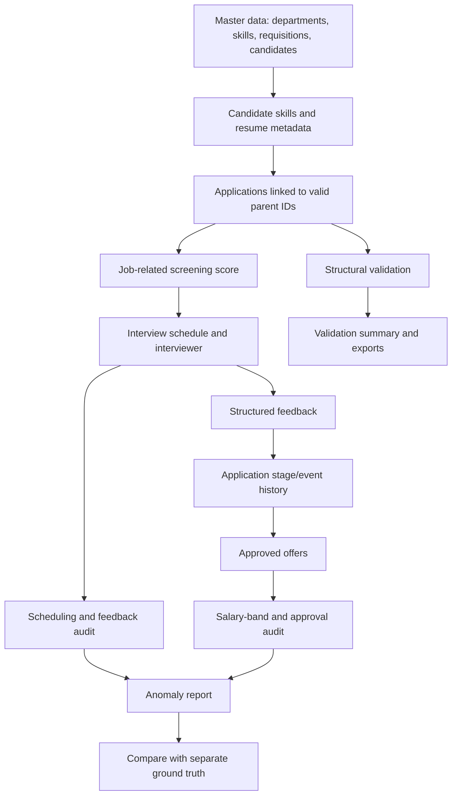

# Recruitment Workflow & Data Quality Engine

A reproducible, locally runnable Python project for generating synthetic recruitment data and auditing workflow exceptions across requisitions, candidates, applications, interviews, feedback, and offers.

> **Purpose:** demonstrate deterministic data generation, relational integrity, explainable job-related screening, labelled exception cases, and audit-ready outputs.

## At a glance

- **Reproducible:** fixed seed and SHA-256 checksums in the generated manifest.
- **Relational:** CSV/JSON exports plus a SQLite database and SQL schema.
- **Auditable:** business-rule findings are separated from ground-truth labels.
- **Privacy-conscious:** synthetic profiles and resume metadata only; no real candidate resumes.
- **Local-first:** no API keys, paid services, or hosted infrastructure required.

## What it produces

| Entity / artifact | Baseline target |
|---|---:|
| Job requisitions | 100 |
| Candidates | 2,000 |
| Required-skill mappings | 3–5 per requisition, stored in `RequisitionSkill` |
| Applications | 3,000 baseline plus 2 labelled exception rows in the default run |
| Interviews | 600 baseline plus 1 labelled conflict row in the default run |
| Offers | 150 |
| Additional outputs | CSV, JSON, SQLite, SQL schema, source/data manifests, validation summary, anomaly report, metrics, ground truth |

The baseline targets are distinct from intentionally injected exception records. With the default seed and scale, the expected observed counts are 3,002 applications and 601 interviews because two application exceptions and one interview conflict are deliberately added. Exact observed counts are recorded in `data/generated/manifest.json` after generation.

## Quick start — Windows

Install Python 3.10 or newer. From the project root in PowerShell:

```powershell
py -m venv .venv
.\.venv\Scripts\Activate.ps1
python -m pip install --upgrade pip
pip install -e ".[test]"
python -m recruitment_engine.engine generate --out data/generated --seed 20261022 --scale 1
python -m recruitment_engine.engine audit --data data/generated
pytest -q
```

If PowerShell blocks activation, you can call `.\.venv\Scripts\python.exe` directly instead. See [`START_HERE.txt`](START_HERE.txt) for the shortest run path.

## Quick start — macOS / Linux

```bash
python3 -m venv .venv
. .venv/bin/activate
python -m pip install --upgrade pip
pip install -e '.[test]'
python -m recruitment_engine.engine generate --out data/generated --seed 20261022 --scale 1
python -m recruitment_engine.engine audit --data data/generated
pytest -q
```

## Repository layout

```text
.
├── src/recruitment_engine/   # Generator, structural validation, and audit rules
├── tests/                    # Automated tests for determinism and key anomaly detection
├── data/generated/           # Reproducible CSV/JSON exports and SQLite seed database
├── docs/                     # Data dictionary, architecture, review checklist, AI prompt log
├── scripts/                  # Reproducibility and verification helpers
├── evidence/                 # Locally generated verification summaries
├── START_HERE.txt            # Reviewer-oriented first-run instructions
├── START_WINDOWS.bat         # Windows convenience launcher
├── pyproject.toml            # Package metadata and test configuration
└── README.md
```

## Data model and workflow



See the [documentation index](docs/README.md) for the full guide set: architecture, data dictionary, relationship model, business rules, lifecycle, QA plan, design decisions, operations, provenance, reviewer guide, and AI prompt history.

## Example metrics from the default seed

The checked-in `data/generated/metrics_summary.json` contains metrics calculated from the generated operational records. For seed `20261022`, the current generated snapshot reports:

| Metric | Observed value |
|---|---:|
| Applications | 3,002 |
| Screening pass rate | 26.55% |
| Average screening score | 43.58 / 100 |
| Completed interviews | 287 |
| Completed-interview feedback coverage | 99.65% |
| Offers | 150 |
| Offer acceptance rate | 23.33% |
| Offers within salary band | 99.33% |

These are synthetic sample outputs, not industry benchmarks. The intentionally injected salary-band anomaly affects the in-band rate. Re-run the generator to reproduce the values for the documented seed.

## Business rules and exception coverage

The generated dataset includes labelled examples for:

1. Duplicate candidate/requisition application.
2. Interviewer schedule conflict.
3. Application advanced without required feedback.
4. Offer salary outside the requisition's approved band.
5. Active application linked to a closed requisition.

Screening uses job-related skill coverage and experience only. Demographic characteristics and demographic proxies are not screening features. Known injected anomalies are expected audit findings, not silently corrupted records.

## Outputs and how to interpret them

- `*.csv` / `*.json`: operational entity data.
- `schema.sql` and `recruitment_seed.sqlite`: relational schema and local database.
- `manifest.json`: seed, scale, row counts, and SHA-256 checksums.
- `source_manifest.json`: provenance statement documenting that all records are synthetic and no external dataset is used.
- `metrics_summary.json`: derived operational metrics for screening, stages, feedback coverage, and offers.
- `validation_summary.json`: structural validation result.
- `anomaly_report.csv` / `anomaly_report.json`: business-rule findings computed from operational records.
- `ground_truth.csv` / `ground_truth.json`: separately stored labels for known injected cases; **never use these labels as screening input features**.

Regenerate twice into separate directories to verify determinism:

```powershell
python -m recruitment_engine.engine generate --out data/run_a --seed 20261022 --scale 1
python -m recruitment_engine.engine generate --out data/run_b --seed 20261022 --scale 1
python scripts/verify_reproducibility.py data/run_a data/run_b
```

The verifier compares file names, bytes, and SHA-256 checksums. It exits non-zero if outputs differ.

## Testing and validation

```bash
pytest -q
python -m recruitment_engine.engine audit --data data/generated
```

The tests cover fixed-seed reproducibility, baseline record counts, separation of ground truth, required anomaly labels, detection of representative audit findings, SQLite foreign-key integrity, and allowed lifecycle transitions. Read [`docs/VALIDATION.md`](docs/VALIDATION.md) and [`docs/QA_TEST_PLAN.md`](docs/QA_TEST_PLAN.md) for what is and is not proven by these checks. The [`evidence/`](evidence/README.md) directory records the latest local test run, row counts, anomaly coverage, SQLite integrity, metrics snapshot, and evidence-file checksums.

## Assumptions and limitations

- This is a data-generation and audit engine, not a production applicant-tracking system or hosted web dashboard.
- Interview availability is simulated using the synthetic schedule: baseline interviews use 45-minute slots within the defined 09:00–17:00 working window and are assigned so each interviewer has at most one baseline interview per generated day. It is not integrated with a live calendar. The deliberate conflict row is added after the baseline schedule and must be flagged by the audit.
- Approval identities are synthetic data; there is no authentication or real approval service.
- Lifecycle events provide a minimal trace of stage changes; they are not a complete event-sourced application architecture.
- Review the implementation and test results before relying on any reported metric. The project should not be treated as production hiring software.

## AI assistance and work log

AI assistance was used during planning and implementation. The prompt log records the available history and explicitly identifies any summaries or omissions. Update [`docs/PROMPT_HISTORY.md`](docs/PROMPT_HISTORY.md) with the actual prompts submitted to every AI tool you used; do not claim it is a complete transcript until you have checked it. Review, run, and understand the submitted code and tests yourself, and describe accurately what you personally changed or verified.

## License

See [`LICENSE`](LICENSE). The generated records are synthetic and intended for demonstration and evaluation.
