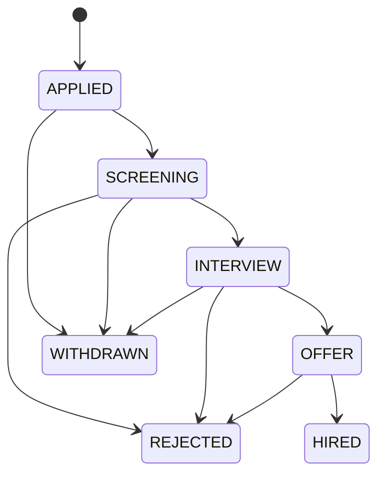

# Application lifecycle and event history

## Purpose

Applications have a current stage and an associated sequence of `ApplicationEvent` records. The event history is intended to make progression reviewable instead of relying only on a mutable current-state field.

## Typical progression

The diagram is a conceptual view of the intended progression. Consult the transition map implemented in `src/recruitment_engine/engine.py` for the exact allowed values used by this version.

## Review checklist

- Does every event reference an existing application?
- Are event timestamps/dates ordered?
- Does each `from_stage` match the preceding state where required?
- Is each `to_stage` allowed by the transition policy?
- Is the current application state consistent with the final recorded event?
- Is any intentionally invalid progression identified in ground truth?

## Traceability boundary

The current model preserves a minimal stage-transition history. It does not implement full event sourcing, event replay as the sole source of truth, distributed event delivery, or a user-facing approval workflow.
